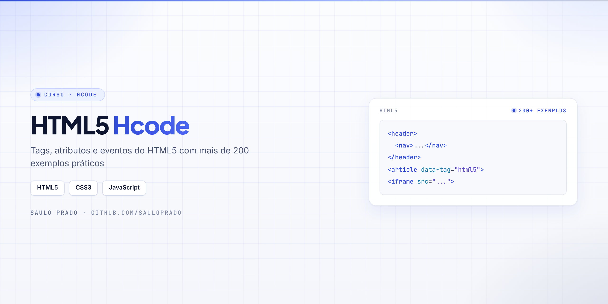

<p align="center">

</p>

<h1 align="center">HTML5 — Hcode</h1>
<p align="center"><i>Tags, atributos e eventos do HTML5 com mais de 200 exemplos</i></p>

<p align="center">


</p>

## Sumário

- [Sobre](#sobre)
- [O que foi praticado](#o-que-foi-praticado)
- [Como visualizar](#como-visualizar)
- [Estrutura do repositório](#estrutura-do-repositório)
- [Autor](#autor)

## Sobre

Material do **curso de HTML5 da Hcode**: exemplos de cada tag, apresentações sobre atributos e eventos e páginas de prática.

## O que foi praticado

| Conteúdo | Conceito |
| --- | --- |
| `exemplos/html5-exemplos-master/` | Mais de 200 exemplos, um por tag ou atributo do HTML5 |
| `Apresentação Atributos/` | Apresentação sobre atributos globais |
| `Eventos HTML5/` | Apresentação sobre eventos |
| `iframe.html` | Incorporação de conteúdo externo |
| `investing.html` | Página de câmbio de moedas com conteúdo incorporado |
| `code.html` · `print.html` | Tags de código e impressão |
| `globo*.html` | Exercícios de layout |

## Como visualizar

Clone o repositório e abra os arquivos `.html` no navegador:

```bash
git clone https://github.com/sauloprado/Curso-Html5-Hcode.git
```

## Estrutura do repositório

```text
Curso-Html5-Hcode/
├── exemplos/html5-exemplos-master/   # 200+ exemplos
├── Apresentação Atributos/
├── Eventos HTML5/
├── iframe.html
├── investing.html
├── code.html
├── print.html
├── globo.html … globo4.html
└── assets/capa.png
```

## Autor

**Saulo Prado** · Analista de Sistemas · Gestão de Ativos de TI, orçamento, automação e dashboards

[](https://www.linkedin.com/in/saulo-prado-ab4a0b96/)
[](https://github.com/sauloprado)
